# ADF Data Engineering Pipeline Pro

### An end-to-end Azure data platform: multi-source ingestion, incremental loading, Medallion architecture, automated alerting and CI/CD


---

## 1. Project Overview

### The scenario
Business data is scattered across three very different places:

| Source | Type | Format |
|---|---|---|
| Files on a local machine (`C:\vivFiles`) | On-premises | CSV |
| A GitHub-hosted endpoint | REST API | JSON |
| `dbo.FactBookings` in Azure SQL Database | Relational database | Table |

None of it can be analysed together until it is brought into one governed location and made consistent.

### What I built
A complete data platform on **Azure Data Factory** that:

1. **Ingests** data from all three sources into **Azure Data Lake Storage Gen2**.
2. **Loads incrementally** from SQL so only new records are copied on each run.
3. **Refines** data through a **Bronze, Silver, Gold (Medallion)** architecture using Spark-based Mapping Data Flows and **Delta** tables.
4. **Orchestrates** everything from a parent pipeline.
5. **Monitors** itself: a Logic App emails me the status and error message of every run.
6. Is **source-controlled** in Git and set up for **CI/CD with Azure DevOps**.

### Skills demonstrated

| Skill | Where in this project |
|---|---|
| Hybrid cloud integration | Self-Hosted Integration Runtime (Part 1) |
| Metadata-driven pipelines | Parameters, ForEach, dynamic mapping (Parts 2 and 3) |
| API ingestion | HTTP linked service and Web activity (Part 4) |
| Cloud database design | Azure SQL option selection (Part 5) |
| Incremental ETL | Watermark pattern (Part 6) |
| Orchestration | Execute Pipeline (Part 7) |
| Monitoring | Logic App and Gmail alerts (Part 8) |
| Data transformation and modelling | Silver and Gold layers with Delta (Parts 9 and 10) |

---

## 2. Architecture

```
        SOURCES                         INGESTION                      AZURE DATA LAKE (ADLS Gen2)
 ┌──────────────────────┐
 │ On-prem files (CSV)  │── Self-Hosted IR ──┐
 │ C:\vivFiles          │                    │
 ├──────────────────────┤                    │        ┌───────────────────────────────────────┐
 │ GitHub REST API      │── Azure IR ────────┼──────► │ BRONZE   raw data (Parquet / JSON)    │
 │ (JSON)               │                    │        │    │                                  │
 ├──────────────────────┤                    │        │    ▼  Mapping Data Flow (Spark)       │
 │ Azure SQL Database   │── Azure IR ────────┘        │ SILVER   cleaned & standardised Delta │
 │ dbo.FactBookings     │   (incremental load)        │    │                                  │
 └──────────────────────┘                             │    ▼  Mapping Data Flow (Spark)       │
                                                      │ GOLD     business-ready Delta         │
                                                      └───────────────────────────────────────┘

   Pipeline run ──► Web Activity ──► Logic App ──► Gmail (success / failure alert)
   ADF source code ──► Git (GitHub) ──► Azure DevOps CI/CD
```

**Layer responsibilities**

| Layer | Purpose | Format | Container |
|---|---|---|---|
| Bronze | Raw data exactly as received, so I can always reprocess | Parquet / JSON | `bronze` |
| Silver | Cleaned, typed and standardised data | Delta | `silver` |
| Gold | Aggregated, business-ready tables for reporting | Delta | `gold` |

---

## 3. Tech Stack

| Area | Technology |
|---|---|
| Orchestration and ETL | Azure Data Factory (pipelines, datasets, linked services) |
| Compute | Self-Hosted IR, Azure IR, Spark-based Mapping Data Flows |
| Storage | Azure Data Lake Storage Gen2 |
| Sources | On-prem file system, GitHub REST API, Azure SQL Database |
| File formats | CSV, JSON, Parquet, Delta |
| Alerting | Azure Logic Apps with Gmail connector |
| Version control and CI/CD | Git, GitHub, Azure DevOps |

---

## 4. Azure Environment Setup

**Goal:** create a clean, organised foundation for the whole project.

| Resource | Name | Why it exists |
|---|---|---|
| Resource Group | `VIVEK_RG` | One logical container for every project resource, so cost, access and clean-up are managed together |
| Azure Data Factory | created inside `VIVEK_RG` | The orchestration engine for all pipelines |
| Storage Account (ADLS Gen2) | `vivstorage09` | The data lake, with containers `bronze`, `silver` and `gold` |
| Azure SQL Database | single DB, serverless | The relational source for the incremental load |
| Logic App | HTTP trigger and Gmail | Sends pipeline status emails |
| Self-Hosted Integration Runtime | `viv-selfhosted` | Lets ADF reach my on-prem machine |

**Naming convention I followed:** `ls_` for linked services, `ds_` for datasets, and descriptive pipeline and activity names, so every component is easy to find and understand.

---

## 5. Part 1: On-Premises to Azure Migration

### Objective
Move CSV files stored on my local machine into the Azure data lake, even though ADF runs in the cloud and cannot see my `C:\` drive on its own.

### The challenge
Cloud-hosted ADF cannot reach private or on-prem resources directly. The default Azure Integration Runtime only works with publicly reachable sources.

### Solution: Self-Hosted Integration Runtime

**Step 1: Create and register the IR**
1. In ADF, I went to *Manage, Integration runtimes, New* and chose *Azure, Self-Hosted*.
2. Network environment: **Self-Hosted**. Name: `viv-selfhosted`.
3. I chose **Manual setup**, downloaded the IR installer and installed it on my machine.
4. At the final step of the installer I pasted the **authentication key** that ADF generated. This securely links my machine to my Data Factory.
5. I opened the **Integration Runtime Configuration Manager**, then confirmed in ADF that `viv-selfhosted` showed **Running**.

**Step 2: Create the linked services**

| Linked service | Type | Configuration |
|---|---|---|
| `ls_onprem_file` | File system | Runs on `viv-selfhosted`, host path `C:\vivFiles`, authenticated with my Windows account |
| `ls_datalake` | ADLS Gen2 | Default Azure IR, points to storage account `vivstorage09` |

Keeping the on-prem and cloud connections in **separate linked services** means each can use the right IR and be reused independently.

**Step 3: Build the first pipeline `onpreme_ingestion`**
- Added a **Copy activity** named `MigrationOnPremFile`.
- **Source dataset `ds_onprem`:** file system, **CSV**, linked service `ls_onprem_file`.
- **Sink dataset `ds_onprem_file`:** ADLS Gen2, **Parquet**, path `bronze/onprem/<file_name>`.

**Why CSV to Parquet?** Parquet is columnar and compressed. It keeps data types and is much faster and cheaper to query than CSV. Converting at the Bronze layer gives every later stage a better starting point.

### Result
Debugged the pipeline and it succeeded. The Parquet file appeared in the `bronze/onprem` folder of ADLS Gen2.

### What I learned
The Self-Hosted IR only needs **outbound** connectivity, so no inbound firewall ports need to be opened. It is the standard way to build hybrid pipelines safely.

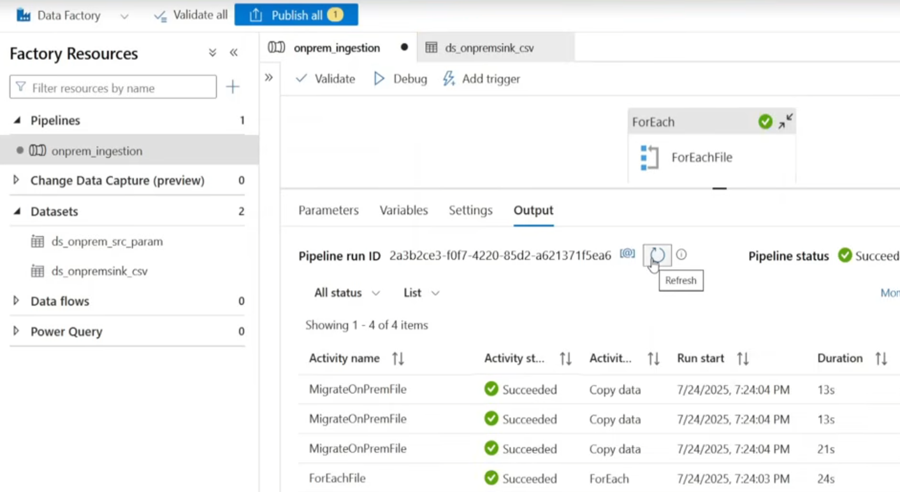

---

## 6. Part 2: Dynamic Pipeline for Multiple Files

### Objective
The first pipeline copied only one file. Real projects have many files, and building one Copy activity per file is slow, repetitive and hard to maintain.

### Approach: parameters and ForEach

1. **Pipeline parameter:** created `files`, type **Array**, containing a JSON list of the files to process.
2. **ForEach activity:** added a ForEach and placed the Copy activity inside it.
3. **Items setting** (dynamic content):
   ```
   @pipeline().parameters.files
   ```
4. **Per-file values inside the Copy activity:** the source and sink datasets use the current loop item:
   ```
   @item().file_name
   ```
5. The loop runs the **same Copy activity once per file, one after another**.

### Why this design
- **One pipeline, any number of files.** Adding a file means editing a parameter, not the pipeline.
- Less duplication means fewer bugs and easier maintenance.
- This is the foundation of a **metadata-driven framework**, where behaviour is controlled by configuration rather than hard-coded.

### Result
All files in the list were copied from `C:\vivFiles` to the Bronze container in a single run.

---

## 7. Part 3: Dynamic Schema Mapping

### Objective
Each file has different columns, so a single static column mapping cannot work for all of them. I needed the Copy activity to apply the **correct mapping for each file at run time**.

### Approach

1. For each file, I configured the column mapping once in the Copy activity, then opened the activity's **Code view** and copied the **mapping (translator) JSON**.
2. I created one **pipeline parameter of type Object per file** and pasted that JSON as its value:
   - `customers_schema`
   - `drivers_schema`
   - `trips_schema`
3. In the Copy activity's **Mapping** setting, I used dynamic content to select the right schema for the current file:

```
@if(
  equals(item().name, 'customers.csv'),
  pipeline().parameters.customers_schema,
  if(
    equals(item().name, 'drivers.csv'),
    pipeline().parameters.drivers_schema,
    pipeline().parameters.trips_schema
  )
)
```

**How it reads:** if the current file is `customers.csv`, use the customers schema. Otherwise, if it is `drivers.csv`, use the drivers schema. Otherwise use the trips schema.

### Result
One pipeline now migrates multiple files, each with its own structure, from on-prem to ADLS Gen2, with the right mapping applied automatically.

### What I learned
ADF expressions can switch whole configuration objects, not just simple values. This turns a Copy activity into a reusable, schema-aware component.

---

## 8. Part 4: REST API Ingestion

### Objective
Ingest data exposed through a web endpoint (hosted on GitHub) and store it in the data lake.

### Pipeline `API_Ingestion`

```
[ Web Activity ] ──(on success)──► [ Copy Activity ]
```

**Step 1: Web activity**
Calls the GitHub URL first. This validates that the endpoint is reachable before any copying starts, so the pipeline fails early and clearly if the source is down.

**Step 2: Copy activity (runs only on success of the Web activity)**

| Component | Name | Configuration |
|---|---|---|
| Source linked service | `ls_github` | HTTP connector with a **Base URL** and a **Relative URL** for the file path |
| Source dataset | `ds_api_source` | HTTP, **JSON** |
| Sink dataset | `ds_api_sink` | ADLS Gen2, **JSON**, using `ls_datalake` |

**Why Base URL and Relative URL?** The base is fixed in the linked service, and only the relative path changes. The same connection can be reused for many endpoints.

### Result
The pipeline ran successfully and the API data landed in ADLS Gen2.

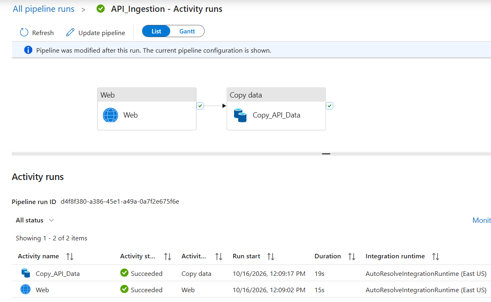

---

## 9. Part 5: Azure SQL Database Setup

### Choosing the right Azure SQL option

| Option | Type | Best for |
|---|---|---|
| **Azure SQL Database** | PaaS | New cloud-native apps and data engineering work |
| **SQL Managed Instance** | PaaS | Lift-and-shift of on-prem SQL Server needing SQL Agent, cross-database queries or linked servers |
| **SQL Server on Azure VM** | IaaS | Full OS-level control or features PaaS does not support |

**My choice: single Azure SQL Database, vCore model, Serverless, General Purpose.**

| Decision | Reasoning |
|---|---|
| Azure SQL Database (not MI or VM) | No need for instance-level features, and PaaS removes patching, backup and HA work |
| vCore (not DTU) | Independent control of CPU and memory, plus reserved capacity and Hybrid Benefit options |
| Serverless | The workload is intermittent. **Auto-pause** and per-second billing keep cost near zero |
| General Purpose | Small data and no need for the low latency of Business Critical or the scale of Hyperscale |
| Single database (not elastic pool) | One workload, so there is nothing to share resources across |

**What I would reconsider for production:** provisioned General Purpose or Business Critical for predictable performance (serverless can have a cold-start delay after auto-pause). I would move to Managed Instance if migrating a real SQL Server with Agent jobs.

### What I created
- An Azure SQL Database.
- Table **`dbo.FactBookings`** with sample records and a **`booking_date`** column, which becomes the **watermark column** for incremental loading in the next part.

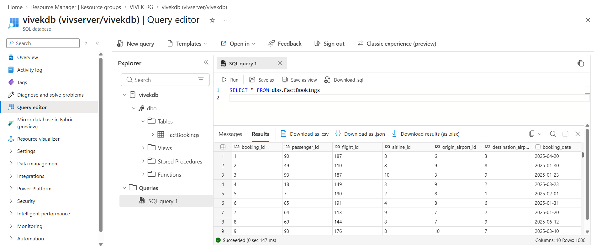

---

## 10. Part 6: Incremental Data Load

### Objective
Copy data from `dbo.FactBookings` to the data lake **without reloading everything on every run**. A full load wastes time and money, and it gets worse as the table grows.

### Design: the watermark pattern

I track two dates:

| Value | Meaning | Where it comes from |
|---|---|---|
| `lastload` | The point up to which data was already loaded | A JSON file in the lake |
| `latestload` | The newest `booking_date` in the source right now | A SQL query |

Each run copies rows in the window **(lastload, latestload]**, then saves `latestload` as the new `lastload`.

### Setup in the data lake

```
bronze/
└── monitor/
    ├── emptyjson/
    │   └── empty.json            { }
    └── lastload/
        └── lastload.json         {"lastload":"1900-01-01T00:00:00"}
```

`lastload.json` is **seeded with a very old date (1900-01-01)**, so the very first run automatically loads the full history. `empty.json` is a dummy file used later to update the watermark.

### Pipeline flow

```
 Lookup: LastLoad ───┐
                     ├──► Copy: copysqldata ──► Copy: update lastload.json
 Lookup: LatestLoad ─┘
```

**Activity 1: `LastLoad` (Lookup)**
Reads `lastload.json` from the lake and exposes `lastload`.

**Activity 2: `LatestLoad` (Lookup)**
Runs this query against Azure SQL:
```sql
SELECT MAX(booking_date) AS latestload
FROM dbo.FactBookings
```

**Activity 3: `copysqldata` (Copy)**
Starts only after both lookups finish. It copies just the new window to Parquet in Bronze:
```sql
SELECT * FROM dbo.FactBookings
WHERE booking_date >  '@{activity('LastLoad').output.firstRow.lastload}'
  AND booking_date <= '@{activity('LatestLoad').output.firstRow.latestload}'
```

**Activity 4: update the watermark (Copy)**
Runs after the data copy succeeds:
- **Source:** the dummy `empty.json`, with an **Additional column** `lastload` whose value is `@activity('LatestLoad').output.firstRow.latestload`.
- **Sink:** `bronze/monitor/lastload/lastload.json`.
- The file is overwritten with the new watermark, **using no custom code**.

### Why the boundaries are `>` and `<=`
- `>` **lastload** means rows from the previous run are never copied twice (**no duplicates**).
- `<=` **latestload** means the newest row is included, and rows that arrive while the pipeline is running wait for the next run (**no gaps**).

### How the runs behave

| Run | lastload | latestload | Result |
|---|---|---|---|
| 1 | 1900-01-01 | newest date in table | Full historical load |
| 2 (no new data) | previous latestload | same date | 0 rows copied |
| 3 (new bookings added) | previous latestload | new newest date | Only new rows copied |

### Order matters
The watermark is updated **only after the data copy succeeds**. If the copy fails, `lastload` stays the same, so the next run retries the same window and no data is lost.

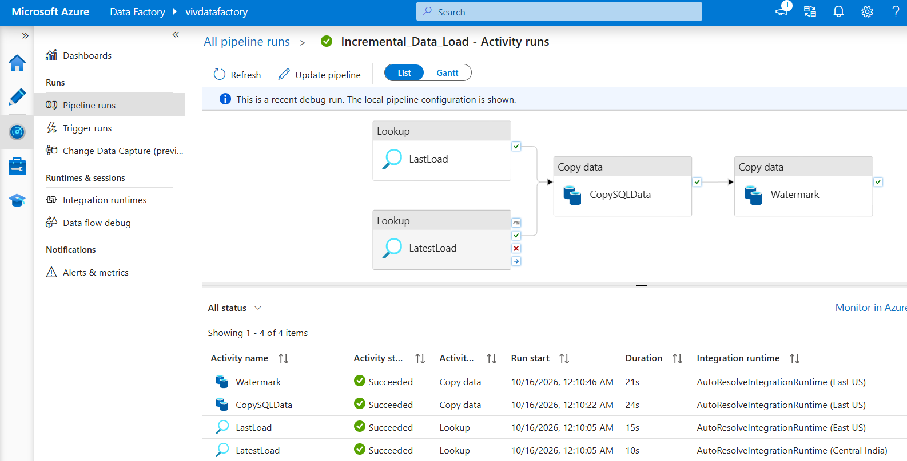

---

## 11. Part 7: Pipeline Orchestration

### Objective
I had several independent pipelines (on-prem ingestion, API ingestion, incremental load, Silver, Gold). I wanted to run them in the right order from one place.

### Approach
I used the **Execute Pipeline** activity in a parent pipeline to call the existing pipelines as child pipelines.

```
Master pipeline
   ├── Execute Pipeline ─► ingestion pipelines   (Bronze)
   ├── Execute Pipeline ─► silverLayer           (Silver)
   └── Execute Pipeline ─► goldLayer             (Gold)
```

### Benefits
- **Modularity:** each pipeline does one job and can still be run on its own.
- **Reusability:** the same child pipeline can be called from different parents.
- **Control:** the order Bronze, Silver, Gold is enforced through activity dependencies.
- **One entry point** to run, schedule or monitor the entire flow.

  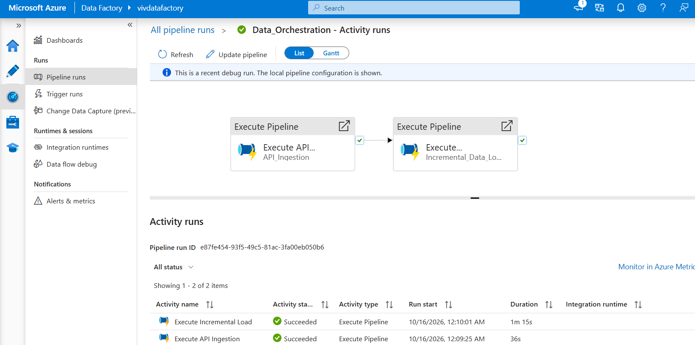

---

## 12. Part 8: Automated Email Alerts

### Objective
Get an automatic email whenever a pipeline succeeds or fails, including the run ID and the actual error message, so failures can be traced immediately without opening the portal.

### Architecture

```
ADF Web Activity ──(HTTP POST)──► Logic App (HTTP trigger) ──► Gmail "Send email (V2)"
```

### Step 1: Build the Logic App
1. Created a **Logic App** resource in Azure.
2. **Trigger:** *When an HTTP request is received*, with a **Request Body JSON Schema** defining the expected fields (`pipeline_name`, `run_id`, `status`, `error`).
3. **Action:** *Send email (V2)* using the **Gmail** connector, with an email template built from those fields.
4. On saving, Azure generated an **HTTP POST URL**, which is the endpoint ADF calls.

### Step 2: Call it from ADF
I added a **Web activity** to the incremental load pipeline (on the failure path, and for success notification). Settings: URL = the Logic App endpoint, Method = `POST`, Body:

```json
{
  "pipeline_name": "@{pipeline().Pipeline}",
  "run_id": "@{pipeline().RunId}",
  "status": "@{activity('Execute API Ingestion').Status}",
  "error": "@{if(equals(activity('Execute API Ingestion').Status, 'Failed'), activity('Execute API Ingestion').error.message, 'Succeeded')}"
}
```

| Field | Value |
|---|---|
| `pipeline_name` | Which pipeline ran |
| `run_id` | Unique run identifier, for finding the run in ADF Monitor |
| `status` | `Succeeded` or `Failed` for the monitored activity |
| `error` | The real error message on failure, otherwise `Succeeded` |

### Result
I tested both scenarios. A **success email** arrives when the pipeline completes, and a **failure email with the actual error text** arrives when it breaks.

### What I learned
Dynamic content such as `pipeline().RunId` and `activity('...').error.message` makes alerts genuinely useful. The activity name inside `activity('...')` must match the real activity name exactly.

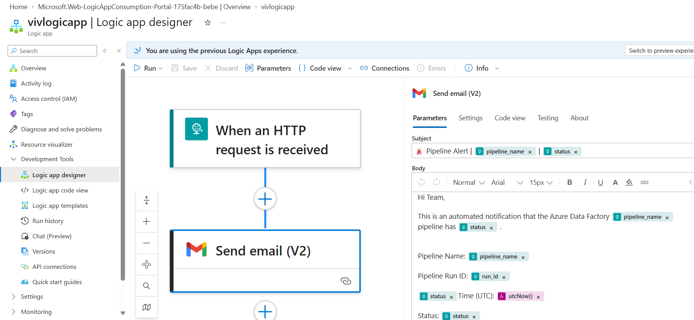

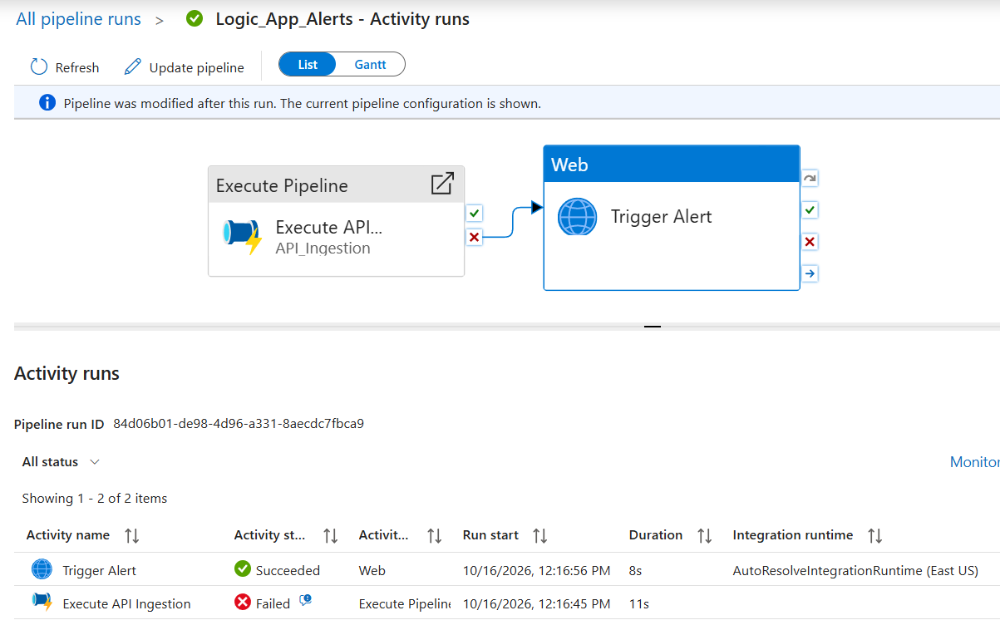

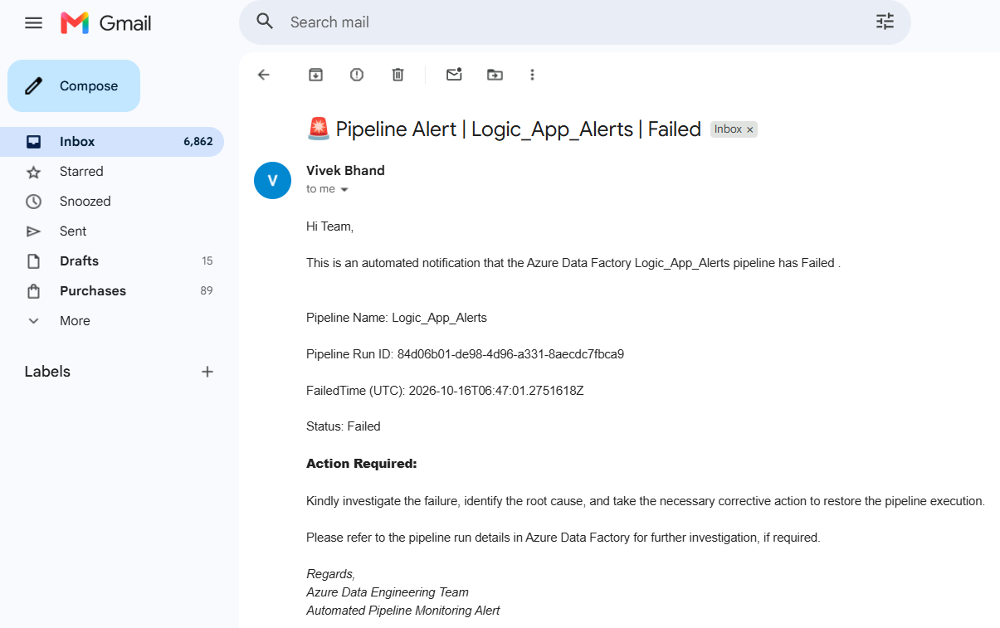

---

## 13. Part 9: Silver Layer

### Objective
Turn raw Bronze data into **clean, consistent, correctly typed** data that analysts can trust.

### Implementation
- **Pipeline:** `silverLayer` containing a single **Data Flow activity**.
- **Data Flow:** `silverTransformations`, which runs on Spark.
- **Datasets processed:** `DimAirline`, `DimFlight`, `DimPassenger`, `FactBooking`, `DimAirports`.

### Common ending for every table
Each stream finishes with the same two steps:

1. **Alter Row** with policy **Upsert** and condition `1==1` (all rows are marked for upsert).
2. **Sink:** inline dataset, type **Delta**, written to its own folder in the `silver` container.

**Why Delta with upsert?** Re-running the flow updates existing records instead of duplicating them, so the pipeline is safe to run repeatedly.

### Transformations per table

#### DimAirline
```
Source ➜ Derived Column ➜ Alter Row ➜ Sink (silver/DimAirline)
```
- Converted `country` to **upper case** for consistency, so `india`, `India` and `INDIA` do not become separate groups later.

#### DimFlight
```
Source ➜ Select ➜ Alter Row ➜ Sink (silver/DimFlight)
```
- Renamed `departure_time` to `departure_timestamp` and `arrival_time` to `arrival_timestamp` for clearer, more accurate column names. All other columns were passed through.

#### DimPassenger
```
Source ➜ Select ➜ Derived Column (M) ➜ Derived Column (F) ➜ Filter ➜ Derived Column (split) ➜ Derived Column (first name) ➜ Alter Row ➜ Sink
```
1. **Select:** renamed `gender` to `gender_flag`.
2. **Derived Column:** `regexReplace(gender_flag, "M", "Male")`.
3. **Derived Column:** `regexReplace(gender_flag, "F", "Female")`.
4. **Filter:** `age > 25`, so only passengers above 25 are kept.
5. **Derived Column:** `split(full_name, " ")` splits the full name into an array.
6. **Derived Column:** `first_name[1]` takes the first element. Arrays in data flow expressions are **1-indexed**.

#### FactBooking
```
Source ➜ Cast ➜ Alter Row ➜ Sink (silver/FactBooking)
```
- **Cast** changed `ticket_cost` from **double to integer**, enforcing the correct data type.

#### DimAirports
```
Source ➜ Derived Column ➜ Alter Row ➜ Sink (silver/DimAirports)
```
- Converted `airport_name` to **upper case** for standardisation.

### Result
I debugged the pipeline and it succeeded. Each table was written as a **Delta** table in its own folder in the `silver` container. The whole layer was built using only the **ADF Data Flow activity**, with no external code.

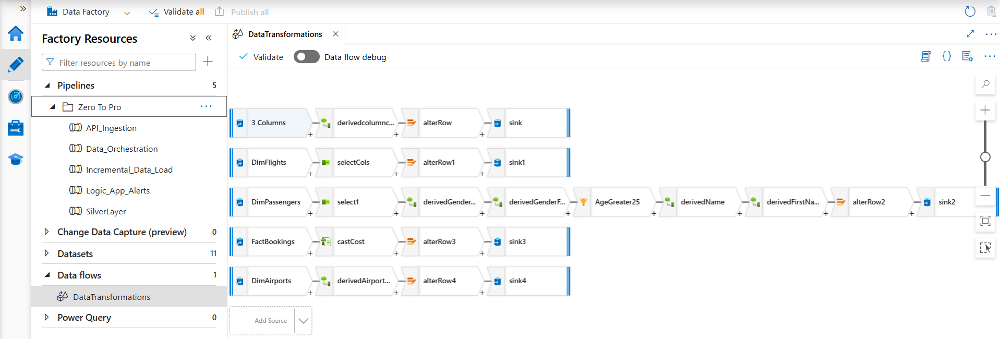

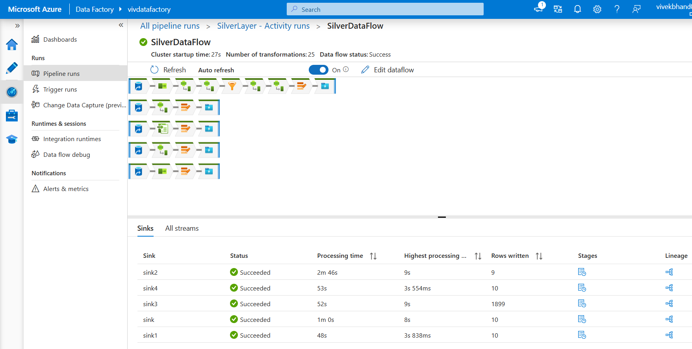

---

## 14. Part 10: Gold Layer

### Objective
Build **business-ready datasets** that answer real questions and can be connected directly to a reporting tool.

### Implementation
- **Pipeline:** `goldLayer` containing a **Data Flow activity**.
- **Data Flow:** `dataserving`.
- **Sources:** the Silver Delta tables, read with an **inline dataset of type Delta**.
- **Every output** ends with **Alter Row (Upsert, `1==1`)** and a **Delta sink** in the `gold` container.

### Gold table 1: Airlines per country
**Question answered:** Which countries have the most airlines?

```
Source (Silver DimAirline) ➜ Select ➜ Aggregate ➜ Alter Row ➜ Sink (gold/DimAirline)
```
- **Select:** kept only `airline_name` and `country`, since unneeded columns add no value to the aggregation.
- **Aggregate:** grouped by `country` and calculated `count(airline_name)`.

### Gold table 2: Flight duration
**Question answered:** How long does each flight take, including flights that land the next day?

```
Source (Silver DimFlight) ➜ Derived Column ➜ Alter Row ➜ Sink (gold/DimFlight)
```
Added the derived column **`derivedTotalDuration`** (in minutes). Each time is first converted to minutes since midnight (`hours × 60 + minutes`). If the arrival is *earlier* than the departure, the flight crosses midnight, so **1440 minutes (24 hours) are added**:

```
iif(
  (toInteger(left(arrival_timestamp,2))*60 + toInteger(right(arrival_timestamp,2)))
  <
  (toInteger(left(departure_timestamp,2))*60 + toInteger(right(departure_timestamp,2))),

  (toInteger(left(arrival_timestamp,2))*60 + toInteger(right(arrival_timestamp,2))) + 1440
  - (toInteger(left(departure_timestamp,2))*60 + toInteger(right(departure_timestamp,2))),

  (toInteger(left(arrival_timestamp,2))*60 + toInteger(right(arrival_timestamp,2)))
  - (toInteger(left(departure_timestamp,2))*60 + toInteger(right(departure_timestamp,2)))
)
```
**Edge case handled:** a flight departing 23:30 and arriving 01:15 would otherwise produce a **negative** duration. The overnight rule makes it a correct 105 minutes.

### Gold table 3: Top 5 airlines by revenue
**Question answered:** Which 5 airlines generate the most sales?

```
Source (Silver FactBooking)
   ➜ Join (Left Outer) with DimAirline
   ➜ Select
   ➜ Aggregate
   ➜ Window (denseRank)
   ➜ Filter (top 5)
   ➜ Alter Row ➜ Sink (gold/FactBooking)
```

| Step | What I did | Why |
|---|---|---|
| **Left outer join** with `DimAirline` | Brought `airline_name` onto each booking | Keeps every booking, even one without a matching airline |
| **Select** | Kept all columns and dropped the duplicate `airline_id` | A join produces the key from both sides, so one copy had to go |
| **Aggregate** | Grouped by `airline_name`, `Total_sales = sum(ticket_cost)` | Revenue per airline |
| **Window** | Sorted by `Total_sales` descending and added a rank with `denseRank()` | Ranking without gaps, even when two airlines tie |
| **Filter** | Kept rows with rank 5 or less | Top 5 only |

### Result
I debugged the pipeline and it succeeded. The Gold layer now holds three Delta tables, ready to power dashboards.

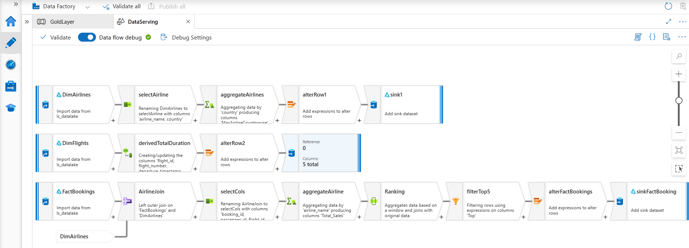

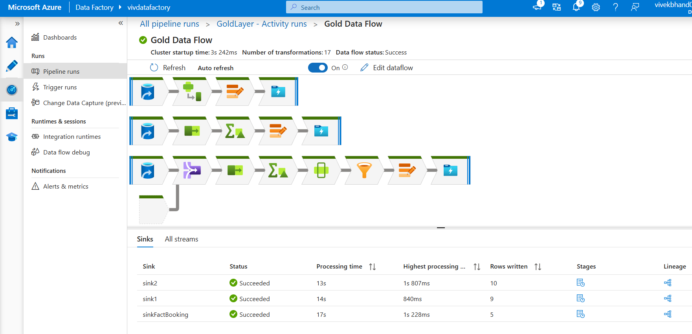

---

## 15. Final Data Lake Layout

```
vivstorage09 (ADLS Gen2)
│
├── bronze/                              RAW
│   ├── onprem/                            Parquet migrated from C:\vivFiles
│   ├── (API data)                         JSON pulled from GitHub
│   ├── (FactBookings)                     Incremental Parquet loads from Azure SQL
│   └── monitor/
│       ├── emptyjson/empty.json
│       └── lastload/lastload.json         Incremental-load watermark
│
├── silver/                              CLEANED (Delta)
│   ├── DimAirline/
│   ├── DimFlight/
│   ├── DimPassenger/
│   ├── FactBooking/
│   └── DimAirports/
│
└── gold/                                BUSINESS-READY (Delta)
    ├── DimAirline/                        Airlines per country
    ├── DimFlight/                         Flight duration (minutes)
    └── FactBooking/                       Top 5 airlines by sales
```

---

## 16. Repository Structure

The repository holds the Git-integrated ADF code. Every ADF component is stored as JSON.

| Path | Contents |
|---|---|
| `pipeline/` | Pipeline definitions |
| `dataset/` | Dataset definitions |
| `linkedService/` | Linked service definitions |
| `dataflow/` | Silver and Gold Mapping Data Flows |
| `factory/` | Factory-level configuration |
| `Data/` | Sample data used in the project |
| `publish_config.json` | ADF publish configuration |

**Version control and CI/CD flow**

```
feature branch ──► pull request ──► main (collaboration branch)
                                        │  Publish in ADF
                                        ▼
                                  adf_publish (ARM templates)
                                        │
                                        ▼
                          Azure DevOps pipeline ──► Test / Prod Data Factory
```

Git integration gives full history, branching and rollback, which the ADF "Save live" mode does not offer. Azure DevOps then deploys the published ARM templates across environments.

---

## 17. Challenges and Design Decisions

| Challenge | Decision and reasoning |
|---|---|
| ADF in the cloud cannot see on-prem files | Used a **Self-Hosted IR** with outbound-only connectivity |
| Many files with different structures | **Parameters + ForEach + Object parameters** for per-file schema mapping instead of one pipeline per file |
| Avoiding full reloads from SQL | **Watermark pattern** with `lastload` and `latestload` |
| Updating the watermark with no code | Copy activity with an **Additional column** on a dummy JSON source |
| Not losing data if a copy fails | Watermark updated **only after** a successful copy |
| Re-runs creating duplicates | **Delta sinks with Alter Row Upsert** |
| Flights that land the next day | **+1440 minutes** rule in the duration expression |
| Ties when ranking airlines | **`denseRank()`** so the top-5 filter is not disturbed by gaps |
| Knowing quickly why a run failed | **Logic App email** carrying run ID and real error message |
| Cost of a learning database | **Serverless** Azure SQL with auto-pause |

---

## 18. Key Learnings

- **Hybrid integration:** a Self-Hosted IR securely bridges on-prem and cloud without opening inbound ports.
- **Metadata-driven design:** parameters, ForEach and expressions turn one pipeline into a reusable framework.
- **Incremental loading:** a simple watermark gives efficient loads, and the exact boundaries and update order are what make it reliable.
- **Medallion architecture:** keeping raw data untouched in Bronze means anything can be rebuilt later.
- **Delta and upserts:** make pipelines idempotent, so they can be re-run safely.
- **Observability:** alerts with run IDs and error text are part of good pipeline design.
- **Cost awareness:** the right Azure SQL tier depends on workload, not habit.

---


## 20. Author

**Vivek Bhand**
Aspiring Data Engineer | Azure Data Factory | ADLS Gen2 | Spark | Delta Lake
